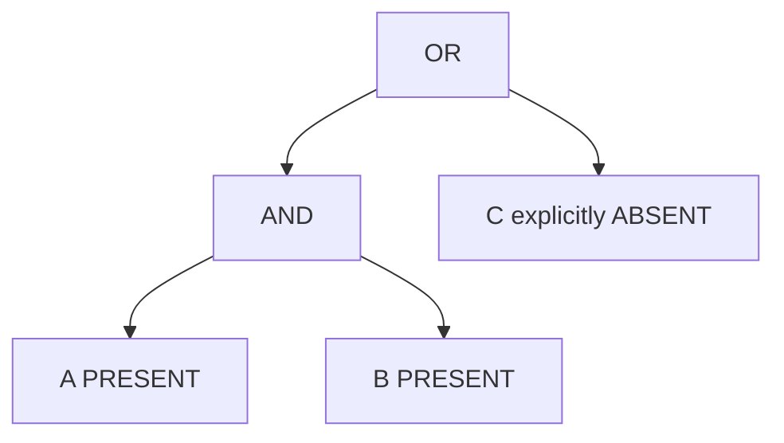

# Summary endpoint: UI integration guide

Status: current middleware implementation, reviewed 2026-11-04.

## 1. What the UI calls

Send a GraphQL POST to `<middleware-base-url>/cb/query` with `Content-Type: application/json`. Local default: `http://localhost:8080/cb/query`.

Use **summary** for both initial page load and filtered cohort summaries. A separate `pageLoadSnapshot` is also proposed as the `summary` only provides study level counts. This route needs to be discussed with the team, but it has been implemented if UI needs to integrate it.

The response is **study-first**: `summary.studies[]` contains each study's participant count and condition/demographic summaries.

## 2. One operation for page load and filters

```graphql
query GetSummary($filter: SummaryFilterInput) {
  summary(filter: $filter) {
    release
    min_count
    seed
    filter
    terms { curie label vocabulary parents }
    research_studies { id name }
    studies {
      research_study
      participant_count
      conditions {
        id
        condition_concept
        participant_count
        values {
          id
          condition_status
          relationship_to_participant
          participant_count
        }
      }
      demographics {
        id
        summarized_slot
        participant_count
        values { id sex race ethnicity participant_count }
      }
    }
  }
}
```

In GraphiQL paste the operation into the query editor and the JSON variables below into the variables editor. Enum values are strings in JSON variables; inline GraphQL enum values are unquoted.

### Initial load or clear all filters

```json
{"filter": null}
```

An empty variables object also works with this operation. Omitting the summary filter argument entirely works as well. Middleware sends Elasticsearch `match_all`; do not send `*`, `seed`, an empty filter object, or an empty AND/OR group. Page load returns supported summaries for the whole indexed population, subject to study availability and suppression.

### Include one concept

```json
{"filter":{"condition":{"concept":"MONDO:0005148","selection":"INCLUDE"}}}
```

### Exclude one concept

```json
{"filter":{"condition":{"concept":"MONDO:0005148","selection":"EXCLUDE"}}}
```

If the UI already represents selection as a condition status, it can send this equivalent include request:

```json
{"filter":{"condition":{"concept":"MONDO:0005148","status":"PRESENT","relationship":"ONESELF"}}}
```

Supply either selection or status. If both are supplied, INCLUDE must agree with PRESENT and EXCLUDE with ABSENT. Prefer one representation consistently.

## 3. Meaning of INCLUDE and EXCLUDE

| UI selection | Required indexed condition record             | Missing/UNKNOWN/HISTORICAL record matches? |
|--------------|-----------------------------------------------|--------------------------------------------|
| INCLUDE      | Exact concept, PRESENT, selected relationship | No                                         |
| EXCLUDE      | Exact concept, ABSENT, selected relationship  | No                                         |

**EXCLUDE means explicitly recorded absence. It does not mean “everyone without a PRESENT record.”** There is no Boolean NOT operator.

Relationship defaults to ONESELF when omitted. Do not send null. Family relationships are accepted when explicitly requested: NATURAL_PARENT, NATURAL_FATHER, NATURAL_MOTHER, NATURAL_SIBLING, NATURAL_BROTHER, NATURAL_SISTER, NATURAL_CHILD, BLOOD_RELATIVE. Availability depends on the indexed data.

Use the actual selected concept's CURIE, not its display label or a `PRESENT|ONESELF|...` string. Accepted direct-concept syntax is `MONDO:` plus seven digits or `HP:` plus seven digits. HPO is the ontology name; the accepted prefix is HP. Matching is exact: no text search, wildcard, synonyms or child-concept expansion happens here. A syntactically valid CURIE does not guarantee indexed data exists.

Each condition's concept/status/relationship must occur in the same condition record. Separate leaves can match separate records for the same participant. If contradictory PRESENT and ABSENT records exist, that participant may match either selection; no latest-record resolution is implemented.

## 4. AND/OR groups and parentheses

Each filter node has exactly one non-null field: `condition`, `summaryId`, `and`, or `or`. AND requires all child expressions; OR requires at least one. Nesting defines parentheses, so the UI must send the expression tree rather than a flat list with implicit precedence. Group arrays must be nonempty. Limits: 8 filter-node levels and 100 total nodes, including groups.

### (INCLUDE A AND INCLUDE B) OR EXCLUDE C

A = HP:0000822, B = MONDO:0005015, C = HP:0000819.

```json
{
  "filter": {
    "or": [
      {"and": [
        {"condition": {"concept": "HP:0000822", "selection": "INCLUDE"}},
        {"condition": {"concept": "MONDO:0005015", "selection": "INCLUDE"}}
      ]},
      {"condition": {"concept": "HP:0000819", "selection": "EXCLUDE"}}
    ]
  }
}
```



### INCLUDE A OR (EXCLUDE A AND EXCLUDE B)

```json
{
  "filter": {
    "or": [
      {"condition": {"concept": "HP:0000822", "selection": "INCLUDE"}},
      {"and": [
        {"condition": {"concept": "HP:0000822", "selection": "EXCLUDE"}},
        {"condition": {"concept": "MONDO:0005015", "selection": "EXCLUDE"}}
      ]}
    ]
  }
}
```

This means A PRESENT OR (A ABSENT AND B ABSENT). 

## 5. Selecting demographic facets with summary IDs

Direct concept leaves are the preferred condition input. Demographic selection uses a returned `summaryId`. Treat IDs as opaque: copy them from the response, do not build or decode them in UI code.

For example, locate the `demographics` item whose `summarized_slot` is `sex`, then choose a `values` item whose `sex` is `FEMALE`. Send that value's `id`:

```javascript
const femaleValue = study.demographics
  .find(facet => facet.summarized_slot === "sex")?.values
  .find(value => value.sex === "FEMALE");

// Only enable this action when the value is available.
const variables = femaleValue ? {
  filter: {
    and: [
      { condition: { concept: "HP:0000822", selection: "INCLUDE" } },
      { summaryId: femaleValue.id }
    ]
  }
} : null;
```

| Returned ID selected          | Predicate applied                                                                |
|-------------------------------|----------------------------------------------------------------------------------|
| Condition parent summary ID   | Concept recorded, irrespective of status/relationship; not equivalent to INCLUDE |
| Condition value ID            | Exact concept, status and relationship                                           |
| Demographic parent summary ID | That demographic slot is recorded                                                |
| Demographic value ID          | That slot contains the selected value                                            |

IDs are not study selectors: the predicate applies across all studies, even if the selected facet was displayed under one study. There is currently no study-ID filter argument. There is also no demographic EXCLUDE/NOT operator. OR together multiple acceptable values; AND together distinct requirements. Race is multivalued, so multiple race selections with AND require all selected values.

## 6. Reading and displaying the response

| Field                              | UI use and caveat                                                                                                                |
|------------------------------------|----------------------------------------------------------------------------------------------------------------------------------|
| `release`                          | Data release identifier; retain with results and cached selections.                                                              |
| `min_count`                        | Server-configured reporting threshold; the UI cannot set it per request.                                                         |
| `seed`                             | Currently null; optional in the response schema. Do not use it to reconstruct the selection.                                     |
| `filter`                           | List of IDs mandatory in every branch, not the submitted expression.                                                             |
| `studies[].research_study`         | Real study ID; use as a stable key. Metadata may not yet provide a display name.                                                 |
| `studies[].participant_count`      | Selected participants represented by that study's root documents. Do not sum studies into a unique global total.                 |
| `conditions[].participant_count`   | Participants with that concept recorded, across its statuses/relationships. This is not necessarily a PRESENT count.             |
| `conditions[].values[]`            | Breakdown by explicit status and relationship. Use these for PRESENT/ONESELF counts.                                             |
| `demographics[].participant_count` | Participants with the slot recorded; UNKNOWN can be included.                                                                    |
| `demographics[].values[]`          | Value counts; race is an array and categories may overlap. Do not sum values to derive totals.                                   |
| `terms`                            | Currently CURIE references; labels/vocabulary can be null and parents empty. Use separately resolved labels with CURIE fallback. |
| `research_studies`, `relations`    | Currently empty pending usable metadata; avoid assuming names or hierarchy exist.                                                |

The response `filter` list uses union for AND and intersection for OR. A OR B can return `filter: []` despite being filtered. Always use the request state to decide whether filters are active.

## 7. Error handling and current blockers

GraphQL can return HTTP 200 with an `errors` array and `data.summary: null`. Inspect both HTTP status and GraphQL errors. Do not render a failed query as zero results.

| Error                             | UI action                                                                                                                                                       |
|-----------------------------------|-----------------------------------------------------------------------------------------------------------------------------------------------------------------|
| GraphQL validation/coercion error | Fix query shape, enum or variable types; this may occur before custom error codes are applied.                                                                  |
| `BAD_USER_INPUT`                  | Correct invalid/empty groups, conflicting status/selection, malformed CURIEs/IDs or excessive nesting. Do not retry unchanged.                                  |
| `UPSTREAM_TIMEOUT`                | Show temporary failure; offer a bounded retry.                                                                                                                  |
| `UPSTREAM_UNAVAILABLE`            | Backend disabled/unreachable or incomplete shard response; show unavailable and retry only in a bounded way.                                                    |
| `UPSTREAM_INVALID_RESPONSE`       | Backend data/aggregation cannot safely produce the contract; notify middleware/data owners, rather than repeatedly retrying or changing the selection silently. |
